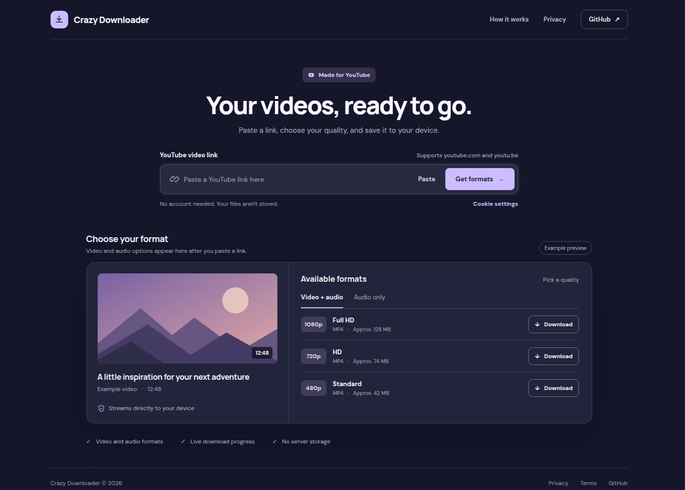

<p align="center">
  
</p>

<h1 align="center"><b>Crazy Downloader</b>
</h1>

Crazy Downloader is a web app for downloading public YouTube videos. Paste a link, pick a
format, and the file streams straight to your device — no account, no database, and nothing
stored on the server.

A companion browser extension exports the YouTube cookies that the app needs when YouTube asks
to confirm you are not a bot, or for age-restricted videos.

[](https://github.com/nayandas69/crazy-downloader/actions/workflows/ci.yml)

[](https://github.com/nayandas69/crazy-downloader/actions/workflows/extension-ci.yml)

[](https://github.com/nayandas69/crazy-downloader/actions/workflows/extension-release.yml)

## Versions

| Component | Version | Source of truth |
| --- | --- | --- |
| Backend (API) | **0.0.1-alpha.1** | `backend/pyproject.toml`, `backend/app/main.py` |
| Frontend (web app) | **0.0.1-alpha.1** | `frontend/package.json` |
| Browser extension | **0.0.2** | `extension/package.json`, both manifests |

The extension uses its own numeric version, as required by browser manifests.

The API reports its version at `/api`, in the OpenAPI schema at `/api/openapi.json`, and in the
interactive docs at `/api/docs`.

## Features

- **Format extraction** — one request lists every downloadable video and audio format with its
  resolution, codec, FPS, and size.
- **Video + audio merging** — video-only (DASH) formats are merged with the best available audio
  stream by ffmpeg, without re-encoding.
- **Streamed downloads** — files are piped from YouTube's CDN to the browser. No video file is
  written to the server.
- **Live progress** — the UI reports phase, percentage, transferred bytes, speed, ETA, and lets you
  cancel mid-download.
- **Cookie support** — paste or upload an exported `cookies.txt`; it stays in browser `localStorage`,
  travels per request in the `X-Cookies` header, and the server deletes its temporary copy after
  each use.
- **Rate limiting** — 30 requests per 60 seconds per IP, applied in memory.

## Tech Stack

| Layer | Technology |
| --- | --- |
| Backend | Python 3.14 · FastAPI · Starlette · yt-dlp 2026.08.19 · yt-dlp-ejs · httpx · ffmpeg |
| Frontend | TypeScript 7 · React 19 · Vite 8 · Tailwind CSS 3 |
| Extension | Manifest V3 · plain ES modules · `node:test` |
| Runtime | Node.js 24 · Deno (yt-dlp's JavaScript runtime) |

## Repository layout

```
crazy-downloader/
├── backend/                FastAPI app, yt-dlp service, tests (see backend/README.md)
├── frontend/               React + Vite SPA, tests (see frontend/README.md)
├── extension/              YouTube Cookies Exporter (see extension/README.md)
├── Dockerfile              single-image build: frontend + backend on port 8000
├── docker-compose.yml      local two-container stack (nginx frontend + API)
├── railway.json            Railway single-service deployment
├── setup.sh                install backend/frontend dependencies locally
└── deploy.sh               build and start the Compose stack
```

## Quick start (Docker)

```bash
git clone https://github.com/nayandas69/crazy-downloader.git
cd crazy-downloader
docker compose up -d --build
```

| URL | What it is |
| --- | --- |
| <http://localhost:3000> | Web app (nginx, `/api` proxied to the backend) |
| <http://localhost:8000/api/health> | API health check |
| <http://localhost:8000/api/docs> | Swagger UI |

`docker compose up -d --build` runs the images built from `backend/Dockerfile` and
`frontend/Dockerfile`: FastAPI with uvicorn, and the compiled SPA served by nginx. Use this stack to
run the compiled app; use the direct commands below while developing.

## Local development

### Prerequisites

- Python **3.14**, ffmpeg, and Deno (the JavaScript runtime yt-dlp uses to solve YouTube's player
  challenges — without it, cookie-authenticated requests can return no formats)
- Node.js **24**
- Or Docker and Docker Compose, for the containerised stack

### Backend

```bash
cd backend
./run.sh                 # installs requirements.txt, then runs uvicorn --reload on :8000
```

or manually:

```bash
cd backend
pip install -r requirements.txt
uvicorn app.main:app --reload --port 8000
```

### Frontend

```bash
cd frontend
npm ci
npm run dev              # Vite dev server on http://localhost:5173
```

The Vite dev server proxies `/api` to `http://backend:8000` (the Compose service name). When the
backend runs directly on your host, change the proxy target in `frontend/vite.config.ts` to
`http://localhost:8000`.

### Helper scripts

```bash
./setup.sh               # installs backend and frontend dependencies
./deploy.sh              # docker compose up -d --build, then prints the URLs
```

## Configuration

| Variable | Where | Default | Purpose |
| --- | --- | --- | --- |
| `PORT` | Backend | `8000` | Port uvicorn binds inside the Docker images; they start uvicorn with `--proxy-headers`. |
| `VITE_API_URL` | Frontend build/dev | empty | Base URL for the `/api/formats` request. Leave empty when `/api` is proxied on the same origin. Download requests always use `/api/download` on the page's own origin so the nginx/Vite proxy applies. |
| `DENO_VERSION` | Root and backend Dockerfiles | `2.9.8` | Deno release installed into the image. |

There is no `.env` requirement: no database, infrastructure credentials, or API keys are used.
`.env.example` documents `PORT` and `VITE_API_URL`; supply them through your shell, Compose, or your
host's environment.

## Deployment

`railway.json` at the repository root deploys the **single-service** image built by the root
`Dockerfile`: Railway builds the frontend, copies `dist/` into the Python image as `backend/static`,
and FastAPI serves both the API and the SPA from one public URL (health check `/api/health`).
`backend/railway.json` and `frontend/railway.json` build and start each image separately if you
prefer two services; the frontend's nginx config still expects the API host to be named `backend`.

### YouTube's bot check

YouTube blocks many datacenter IPs with *Sign in to confirm you're not a bot*. The API detects that
error and returns `cookies_required`; the web app opens the cookie prompt automatically, and one
valid cookie set fixes later requests from that browser.

1. Sign in to YouTube in your browser.
2. Export cookies for `youtube.com` with a `cookies.txt` extension, or run
   `yt-dlp --cookies-from-browser chrome --cookies cookies.txt`. On a phone, use the
   [YouTube Cookies Exporter extension](extension/README.md), which reads the `HttpOnly` session
   cookies a page script cannot.
3. Open **Cookie settings** in the app and paste the text or upload the file.

Cookies live in `localStorage`, are sent per request Base64-encoded in the `X-Cookies` header, and
are written to a temporary file only for the duration of one extraction or download. The server
deletes that file immediately and keeps no copy. Invalid or expired cookies return
`cookies_rejected` so the app asks for a fresh export.

## API reference

| Method | Endpoint | Description |
| --- | --- | --- |
| `GET` | `/api` | Service name, version, and endpoint list |
| `GET` | `/api/health` | Health check (`{"status": "ok", ...}`) |
| `GET` | `/api/formats?url=<youtube-url>` | Extract metadata and all available formats |
| `GET` | `/api/download?url=<youtube-url>&format_id=<id>&title=<title>` | Stream one format (video-only formats are merged with the best audio) |
| `GET` | `/api/docs` | Swagger UI |
| `GET` | `/api/openapi.json` | OpenAPI schema |

Only YouTube URLs are accepted (`youtube.com/watch`, `/embed`, `/v`, `/shorts`, `/live`, and
`youtu.be`). Playlists are not expanded: one video per request. HLS/`.m3u8` formats are filtered out
because they cannot be streamed directly.

### Headers

| Header | Direction | Meaning |
| --- | --- | --- |
| `X-Cookies` | Request | Optional Base64-encoded Netscape `cookies.txt` contents. |
| `Content-Disposition` | Response | Suggested filename. |
| `Content-Length` | Response | Exact size when known. |
| `X-Estimated-Size` | Response | Approximate total for merged streams (sum of video + audio sizes). |

CORS allows any origin (without credentials) and exposes `Content-Disposition`, `Content-Length`,
`Content-Type`, and `X-Estimated-Size` to browser clients.

### Errors

Errors use FastAPI's shape, `{"detail": ...}`, where `detail` is a string or, for cookie errors, an
object with `code` and `message`.

| Status | Cause |
| --- | --- |
| `400` | Missing/invalid URL, extraction failed, or malformed cookies (`invalid_cookies`). |
| `403` | YouTube wants a signed-in session: `cookies_required` (none supplied) or `cookies_rejected` (supplied cookies refused). |
| `404` | The requested `format_id` is not in the extracted format list. |
| `429` | More than 30 requests in 60 seconds from one IP. |
| `500` | Unexpected server error, including a failed ffmpeg merge. |
| `502` | The upstream video stream was unreachable or refused. |

`/api/health`, `/api`, `/api/docs`, and `/api/openapi.json` are exempt from rate limiting.

### Example

```bash
# List formats
curl "http://localhost:8000/api/formats?url=https://youtu.be/U6PZO1n9EPg"

# Download a format (video-only formats auto-merge with the best audio)
curl -L -o video.mp4 \
  "http://localhost:8000/api/download?url=https://youtu.be/U6PZO1n9EPg&format_id=137&title=my_video"
```

Through the web app's origin, replace `:8000` with `:3000`; nginx/Vite proxies `/api` to the
backend.

## How it works

1. **Extraction.** `backend/app/services.py` runs yt-dlp in a worker thread with
   `skip_download=True`, parses each format into `video_audio`, `video_only`, or `audio_only`, and
   caches the result in memory for five minutes. The cache key includes a hash of the cookie set, so
   signed-in and anonymous results are never mixed.
2. **Progressive formats.** Formats that already contain video and audio are proxied with `httpx`,
   forwarding YouTube's headers (and a `Cookie` header built from your cookies when supplied).
3. **DASH formats.** For a video-only format, the backend picks the highest-bitrate audio-only
   stream and pipes both through ffmpeg with `-c copy`. MP4 output is fragmented
   (`-movflags frag_keyframe+empty_moov`) so it can stream; VP9/WebM stays WebM. No temporary files.
4. **Progress.** The frontend reads the response body with the Fetch streaming API and renders the
   `connecting → downloading → merging → finalizing` phases, speed (EMA-smoothed), and ETA.
5. **Cancellation.** An `AbortController` aborts the fetch; the browser stops reading, and the server
   drops the upstream connection.

## Testing and linting

The same commands run in CI (`.github/workflows/ci.yml` for backend/frontend, `extension-ci.yml` for
the extension):

```bash
# Backend — ruff format/check + pytest
cd backend
pip install -r requirements-dev.txt
ruff format --check .
ruff check .
pytest

# Frontend — prettier, type check, vitest
cd frontend
npm ci
npm run format:check
npm run lint
npm test

# Extension — node:test + bundle build
cd extension
npm test
npm run build
```

The Docker build smoke test builds the `./backend` and `./frontend` images.

## Privacy

- **No video storage.** Downloads are piped through and never written to disk.
- **No database or analytics.** Nothing is persisted about users or downloads; server and
  deployment logs may record requests and errors.
- **Cookies** stay in the browser's `localStorage` and are used only for your own requests.
- **Third-party requests.** YouTube is reached through yt-dlp, the header's star counter reads the
  public GitHub REST API (`api.github.com`), and the page loads the Inter font from Google Fonts. No
  account or download data is sent with those requests.

See the in-app privacy policy at `/privacy` for the user-facing wording.

## Browser extension

`extension/` contains the **YouTube Cookies Exporter**, a popup-only extension that writes a
Netscape `cookies.txt` from the browser's cookie store, including the `HttpOnly` session cookies a
page script cannot read. See [`extension/README.md`](extension/README.md) for install, release, and
mobile-browser notes.

## License

For personal and educational use. Please respect YouTube's Terms of Service and applicable copyright laws.

---

<p align="center">Crazy Downloader</p>
